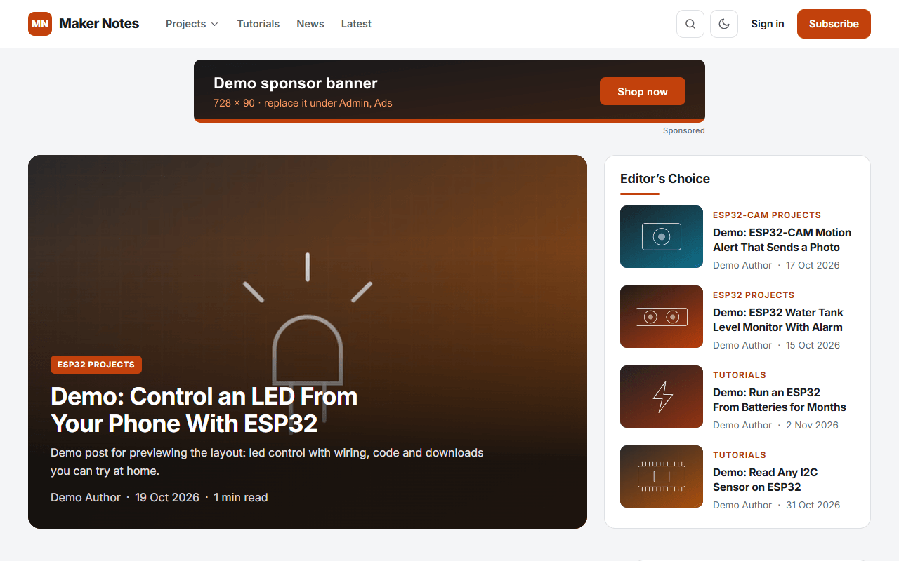
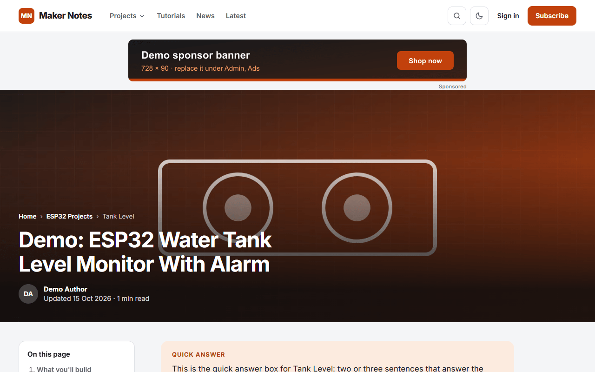
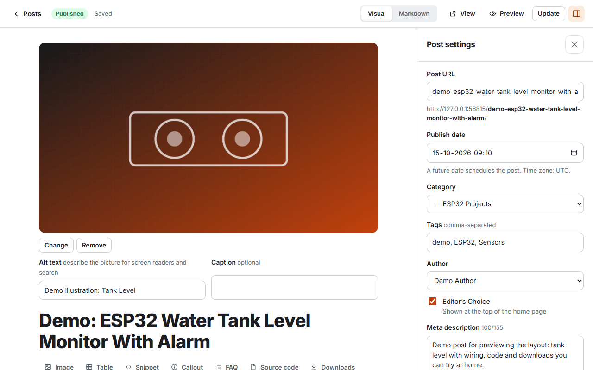
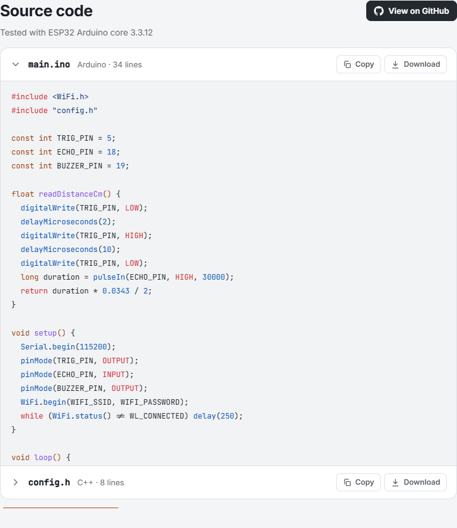
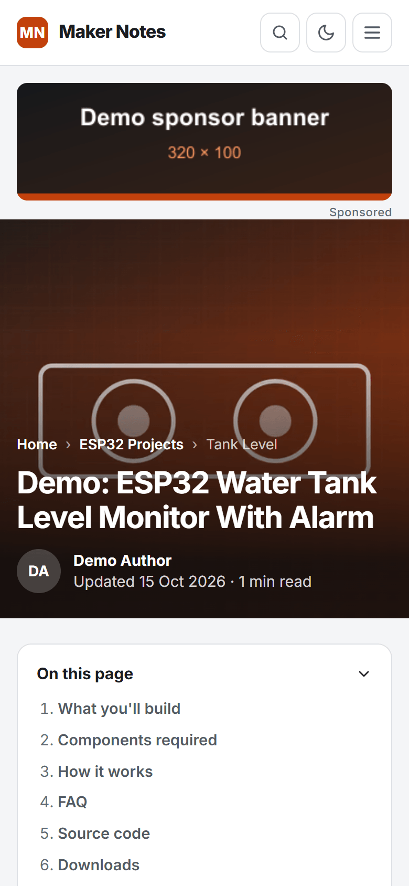
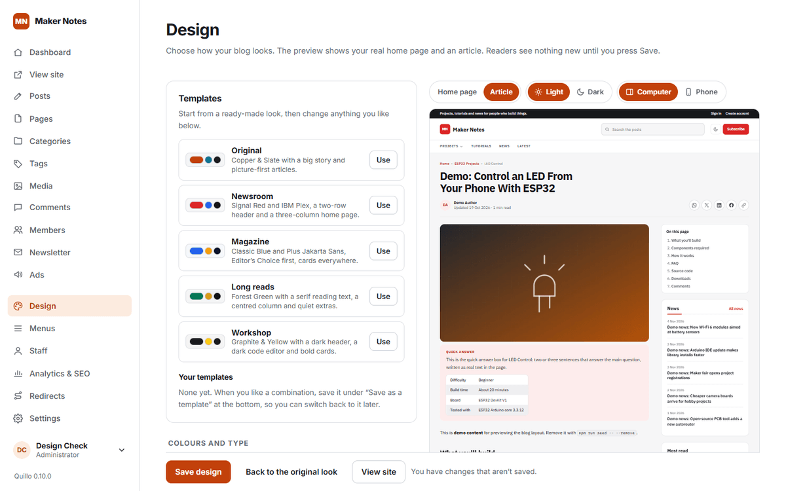
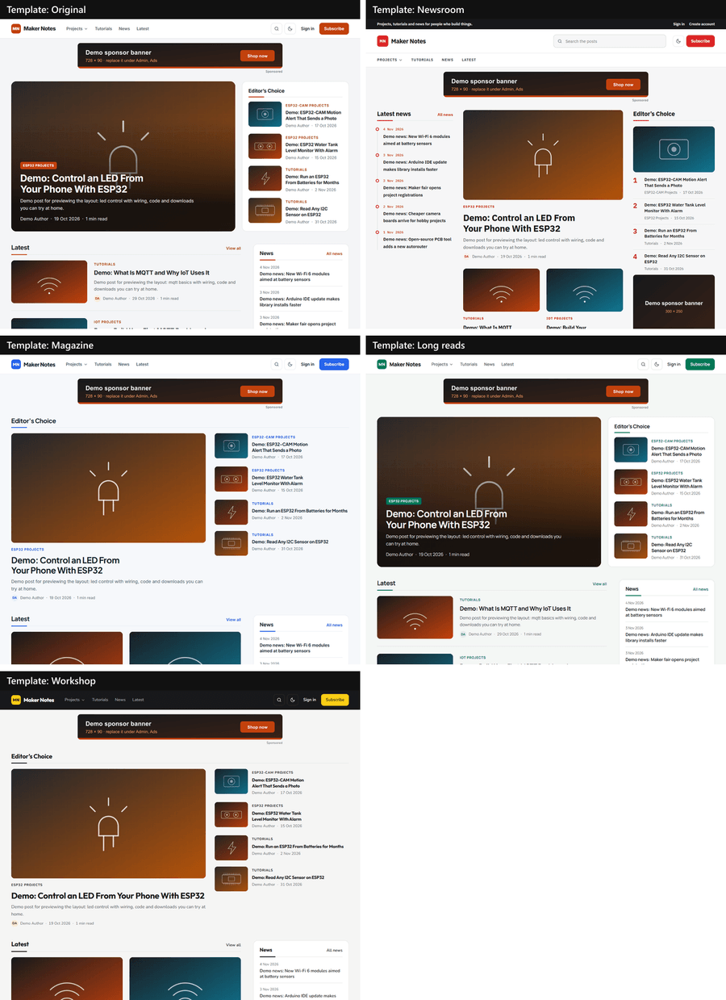

<p align="center">
  
</p>

<h1 align="center">Quillo</h1>

<p align="center">
  <b>A fast, private, self-hosted blog platform.</b><br>
  One small Node server and one SQLite file per blog. No database server, no build step, no trackers.
</p>

<p align="center">
  <a href="CHANGELOG.md"></a>
  <a href="LICENSING.md"></a>
  <a href="docs/development.md"></a>
  <a href="SECURITY.md"></a>
</p>

<p align="center">
  <a href="https://quillo.dhyanalab.in"><b>Website</b></a> ·
  <a href="#features">Features</a> ·
  <a href="#screenshots">Screenshots</a> ·
  <a href="#quick-start">Quick start</a> ·
  <a href="#put-it-online">Put it online</a> ·
  <a href="#documentation">Documentation</a> ·
  <a href="#licence">Licence</a>
</p>

<p align="center">
  <picture>
    <source media="(prefers-color-scheme: dark)" srcset="docs/assets/screenshots/home-dark.png">
    
  </picture>
</p>

## Why Quillo

Quillo gives you a magazine-quality blog that you own outright. Run it on a Raspberry Pi, a small VPS or any machine with Node. Its admin is built for owners who aren't technical: everything is point and click, in plain words.

- **Yours.** One install per blog. Your posts, readers and subscribers stay in one file on your own server.
- **Fast.** Pages are rendered on the server, cached in memory, and served with responsive AVIF and WebP images. Fonts are self-hosted.
- **Private.** No cookies for visitors and no third-party scripts. Analytics, if you want them, are cookieless (Plausible or Umami).
- **Found.** Structured data, social cards, a sitemap, RSS and IndexNow are built in, and articles are written answer-first for search and AI engines.
- **Safe.** Three security audits so far, with two-step sign-in, strict content security policies, encrypted secrets and limits on every sign-in.

## Features

| | |
| --- | --- |
| **Writing** | A visual editor with a Markdown switch. Autosave, revisions, scheduling, a media library, tables, callouts, FAQ sections, and publishing checks that catch broken links and missing alt text. |
| **Your brand** | First-run setup names your blog. Then choose your logo (or initials), region, time zone, menus, footer, and what you call a post: recipe, project, story. |
| **Design** | Choose your look in the admin with a live preview: 6 colour themes, 5 font pairs, light and dark, 3 headers, 3 home pages, 3 article pages, and styles for share buttons, source code, downloads, tables and comments. Start from 5 ready-made templates or save your own. |
| **Readers** | Free reader accounts with email verification, moderated comments with replies and likes, and a reader account page. |
| **Newsletter** | Double opt-in subscriptions, newsletters sent through your own email service, one-click unsubscribe, and a suppression list that survives restores. |
| **Earning** | First-party sponsor banners in nine places, labelled and counted without cookies. An Advertise page fills itself in from your settings. |
| **Search and social** | Open Graph and generated share images, JSON-LD for posts, authors and lists, a sitemap, RSS, IndexNow, and robots rules for AI crawlers. |
| **Makers' tools** | Optional source-code boxes with copy, download and ZIP, download buttons for PDF, STL and ZIP files, a GitHub button, and "Tested with" notes. |
| **Team** | Owner, administrator, editor, author and contributor roles, two-step sign-in, trusted browsers, and an audit log. |
| **Running it** | One command to install as a service, a Cloudflare Tunnel guide, automatic database upgrades with backups, and a command-line tool for owners. |

## Screenshots

<table>
  <tr>
    <td width="50%"><br><sub>Picture-first articles with a contents list and an answer box</sub></td>
    <td width="50%"><br><sub>The editor: visual or Markdown, with post settings beside it</sub></td>
  </tr>
  <tr>
    <td><br><sub>Optional source-code box with copy, download and ZIP</sub></td>
    <td align="center"><br><sub>Every page works on a phone, in light and dark</sub></td>
  </tr>
  <tr>
    <td><br><sub>Admin &gt; Design: pick a look with a live preview</sub></td>
    <td><br><sub>Five ready-made templates, or save your own</sub></td>
  </tr>
</table>

## Quick start

You need **Node 22.13 or newer**. It uses Node's built-in SQLite.

```bash
git clone https://github.com/dhyanalab/Quillo-Blog.git quillo
cd quillo
npm ci
npm run dev
```

The server prints a **setup link and a setup token**. Open the link, paste the token, name your blog and create the owner account.

- Blog: http://localhost:4100/
- Admin: http://localhost:4100/admin/
- Demo content for practice: `npm run seed -- --dev`. Remove it again with `npm run seed -- --remove`.

## Put it online

The simplest home for a blog is a Raspberry Pi or a small VPS behind a **Cloudflare Tunnel**: no router changes, and HTTPS included.

```bash
bash deploy/install.sh https://blog.example.com
```

The install script sets Quillo up as a service that starts at boot and restarts itself. [deploy/README.md](deploy/README.md) walks through the whole thing in four steps, including updates. For nginx, Caddy, backups and restoring, see [docs/deployment.md](docs/deployment.md).

## Documentation

| Guide | What's in it |
| --- | --- |
| [Admin guide](docs/admin-guide.md) | Writing, two-step sign-in, readers and comments, menus, sponsor banners, newsletter, analytics and SEO |
| [Configuration](docs/configuration.md) | Settings in the admin and every server setting (see also [`.env.example`](.env.example)) |
| [Deployment](docs/deployment.md) | Other hosting setups, reverse proxies, backups and restoring |
| [Putting a blog online](deploy/README.md) | Raspberry Pi or VPS with Cloudflare Tunnel, step by step |
| [Development](docs/development.md) | Commands, project layout, design system and packages |
| [Changelog](CHANGELOG.md) | What changed in each version |

## Built with

[Node.js](https://nodejs.org/) (with its built-in SQLite) · [Hono](https://hono.dev/) · [Nunjucks](https://mozilla.github.io/nunjucks/) · [markdown-it](https://github.com/markdown-it/markdown-it) · [Toast UI Editor](https://ui.toast.com/tui-editor) · [sharp](https://sharp.pixelplumbing.com/) · [Satori](https://github.com/vercel/satori) · [Nodemailer](https://nodemailer.com/)

## Roadmap

- **1.0.0 (now):** the Design page. Every owner chooses their own look, with a live preview and templates.
- **Next:** premium design packs, as one of the paid extras.
- See [CHANGELOG.md](CHANGELOG.md) for everything that's done.

## Licence

Quillo is free and open source under the **GNU Affero General Public License v3.0 or later** ([LICENSE](LICENSE)). Use it for any blog, change it, and run it for others. If you run a changed version for other people, share your changes under the same licence.

- **Commercial licence:** need to keep changes private, or sell Quillo under your own brand? A commercial licence is available. See [LICENSING.md](LICENSING.md).
- **Paid services:** hosting, setup, support and premium design packs.

Copyright © 2026 [Dhyana Engineering Solutions](mailto:info@dhyanalab.in), Coimbatore, India.

## Contributing and security

Contributions are welcome. Please read [CONTRIBUTING.md](CONTRIBUTING.md) first; every commit needs a `Signed-off-by` line. To report a security problem, email us as described in [SECURITY.md](SECURITY.md). Please don't open a public issue for it.
